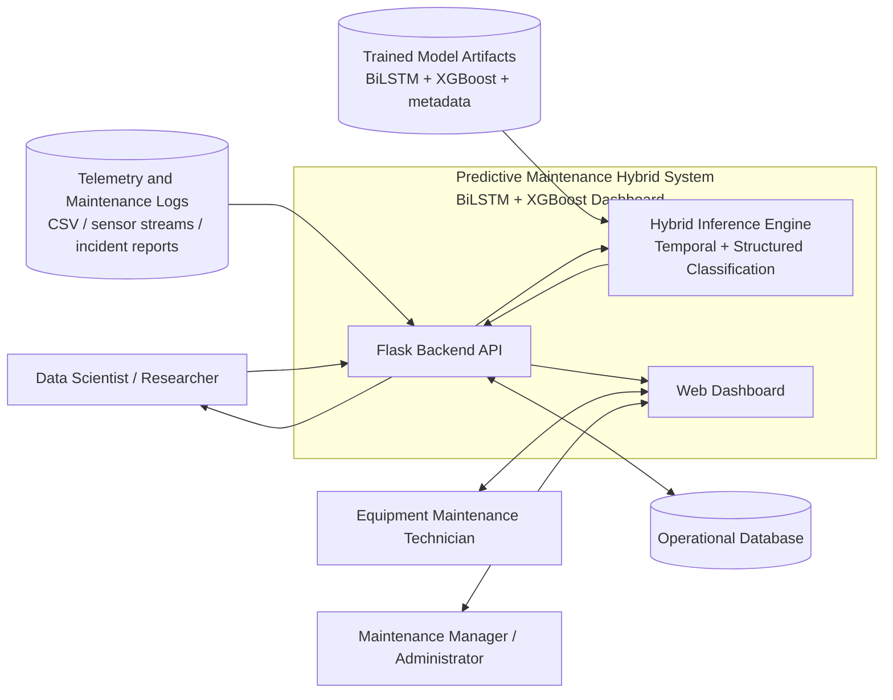
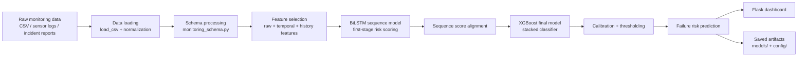
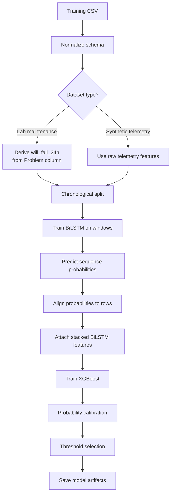
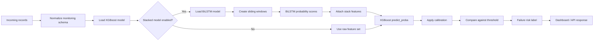
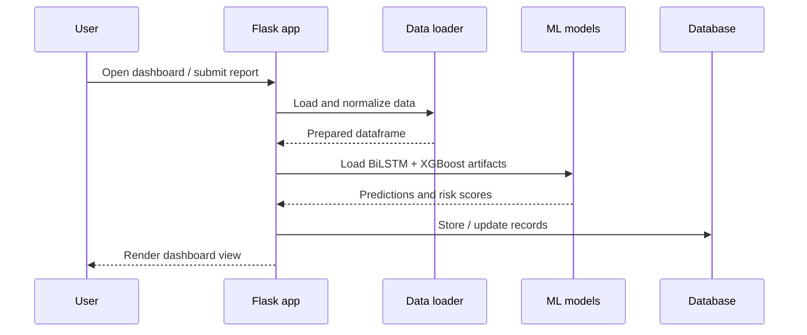
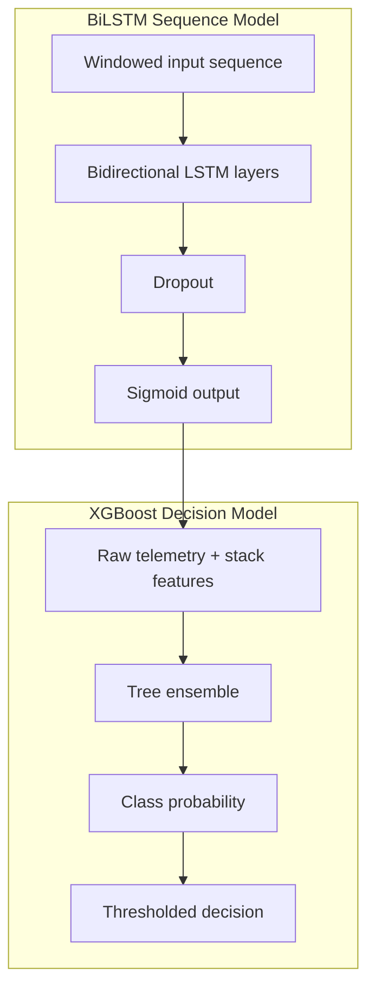

# Defense Diagrams

Use these Mermaid diagrams in slides, reports, or the thesis defense deck.

## 0) Thesis Context Diagram

## 1) System Architecture

## 2) Training Pipeline

## 3) Inference Flow

## 4) Dashboard Deployment

## 5) Model Interaction View

## Notes for the defense

- The BiLSTM is the sequence scorer and the XGBoost model is the final decision layer.
- The stack feature is only available when the model is trained or deployed in stacked mode.
- The dashboard is a Flask app that loads the saved artifacts and displays the resulting risk scores.